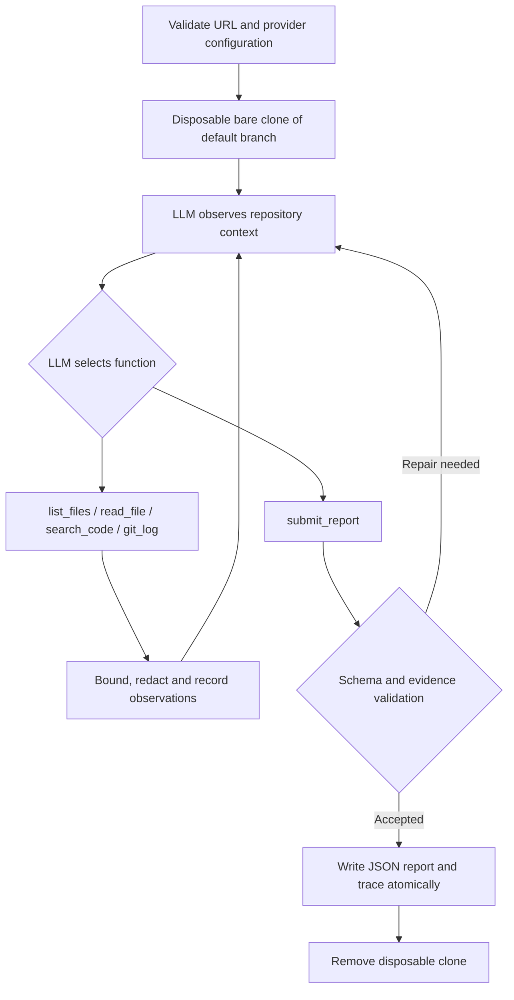

# DevOps Repository Auditing Agent

Assignment 2: an explicit Python agent that investigates public GitHub repositories and produces evidence-backed DevOps findings. Groq selects the tools and follow-up investigations. There are no prebuilt agent or orchestration frameworks.

## Install and configure

Requirements: Python 3.11+, Git on PATH, internet access to GitHub and an LLM API, and a Groq API key with access to a tool-capable model.

```sh
git clone https://github.com/SaifullahKhanSafi/DevOPs-Repository-Auditing-Agent.git
cd DevOPs-Repository-Auditing-Agent
python -m venv .venv
```

Activate on Windows PowerShell:

```powershell
.\.venv\Scripts\Activate.ps1
Copy-Item .env.example .env
```

Activate on Linux/macOS:

```sh
. .venv/bin/activate
cp .env.example .env
```

Install the runtime (standard library only):

```sh
python -m pip install -r requirements.txt
```

Edit `.env` locally, without putting the key in source code or chat:

```dotenv
GROQ_API_KEY=your_groq_key_here
LLM_BASE_URL=https://api.groq.com/openai/v1
LLM_MODEL=openai/gpt-oss-120b
LLM_TIMEOUT=120
LLM_MAX_STEPS=48
```

Create/manage keys in the [Groq console](https://console.groq.com/keys). The configured model must support local function calling; consult [Groq's tool-use documentation](https://console.groq.com/docs/tool-use/overview) and [available models](https://console.groq.com/docs/models). Model availability, quotas and account access can change. This project uses the [OpenAI-compatible endpoint](https://console.groq.com/docs/openai) directly through Python's standard-library HTTP client.

`.env` loads automatically from your current directory. Existing environment variables take precedence. Never commit `.env`. Key precedence is `LLM_API_KEY`, then `GROQ_API_KEY`, then `OPENAI_API_KEY`. Model precedence is `LLM_MODEL`, then `OPENAI_MODEL`. With `GROQ_API_KEY`, the Groq endpoint is selected automatically unless `LLM_BASE_URL` is explicitly set. Other compatible providers work by setting `LLM_API_KEY`, `LLM_BASE_URL`, and `LLM_MODEL`.

## Run the required interface

```sh
python agent.py --repo https://github.com/pallets/click --output report.json
```

No interactive input is requested. Exit code 0 means a completed inspection, including a valid empty `violations` array when nothing defensible is found. Fatal failures return 1 and a safe error on stderr; interruption returns 130. A run containing findings still exits 0: this is an auditor, not an automatic policy gate.

The output has exactly two top-level fields, `repository` and `violations`. Every finding has `rule_id`, `category`, `severity`, `file`, `line`, `description`, `evidence`, and `recommendation`. Severity is `critical`, `high`, `medium`, or `low`; inapplicable locations use JSON `null`. Line numbers are one-based. See [the JSON schema](docs/report.schema.json).

Failed runs can be resumed on the same repository commit without repeating LLM discovery:

```sh
python agent.py --repo https://github.com/pallets/click --output report.json --resume report.trace.jsonl
```

Saved observations are re-executed against that commit before use; completed or mismatched traces are refused without overwriting the trace. Redacted checkpoints are saved after each tool call. Observation IDs are explicitly included in tool results for reliable model citations.

The default audit trace is `report.trace.jsonl`; override it with `--trace path.jsonl`. It records the inspected commit, model-selected tool calls and their purposes, redacted observations, rejected submissions, nine-area coverage, and completion/failure. It does not request or store private model reasoning. Reports are atomically replaced only on success. On failure, an older report is retained; check the exit status and trace before using a report from an earlier run.

## Architecture and pipeline



`agent.py` handles CLI/configuration, temporary acquisition and output. `auditor/llm.py` handles authenticated Chat Completions requests and bounded retries. `auditor/loop.py` implements the observe/reason/select/execute/interpret/report control flow manually. The LLM decides which paths, patterns, scopes and subsequent reads matter; the host enforces tool allowlists, budgets and report grounding. All four inspection tools must have produced observations before completion. That minimum does not prescribe an inspection sequence or file checklist.

| Tool | Inspection behavior |
| --- | --- |
| `list_files(prefix, offset, limit)` | Tracked paths, modes and sizes; paginated discovery, explicit truncation |
| `read_file(path, start_line, max_lines)` | Redacted numbered UTF-8 text; paginated reads; no symlink/submodule following |
| `search_code(pattern, glob, offset, limit)` | Case-insensitive literal search, scoped paths, bounded file pagination; explicit skipped/overflow results |
| `git_log(limit, path)` | Recent commit subjects and changed paths; explicit shallow/default-branch scope |

`record_notes` saves factual findings, citations and outstanding checks for long investigations; it does not request private reasoning. On provider HTTP 413, the host compacts old provider messages and keeps the full evidence ledger/trace. Missing text must be re-read; summaries cannot establish absence. A persistent size rejection fails explicitly.

`submit_report` is a completion tool, not an inspection scanner. Its internal support references must match a real observed file/line and exact redacted quotation. Unsupported reports are returned to the model for correction. Support and coverage are kept in the trace and omitted from the assignment JSON. Exact same rule/location duplicates are removed; the prompt also asks the model to merge semantically duplicated symptoms.

The policy addresses all nine required inspection areas: hygiene, dependencies, quality, testing, CI, security, configuration, collaboration, and build/release. It requires considering alternative CI/test/formatting/locking solutions and distinguishes applications from libraries. An optional file being absent, an unavailable check, or unknown remote branch protection is not proof of a violation. No ML training or experiment tracking is included.

## Safety and practical limits

Targets are cloned as bare Git objects; no checkout, hooks, installs, tests, linting, builds, repository scripts, submodule updates or external tools from the target are executed. Reads address blob IDs from the inspected commit. Git's system/global configuration and credential helpers are disabled for target acquisition, only HTTPS GitHub URLs are accepted, redirects are disabled, and Git calls time out. The target remote and any developer checkout stay unchanged.

Repository content is untrusted evidence, including README instructions and commit messages. It only enters tool messages; the system policy tells the LLM to disregard embedded instructions. This reduces prompt-injection risk but does not guarantee model immunity. Evidence checks verify that cited text exists; they cannot mathematically prove the model's semantic conclusion.

Recognizable keys, private-key bodies, credential assignments, credential URLs, bearer tokens and the configured API key are redacted before observations reach the provider or trace. Redaction preserves line numbering. Redaction is heuristic: unknown credential formats or unusual encodings may be missed. Source text is sent to your configured LLM provider after redaction; only audit repositories you may process this way.

Bounds: 180-second clone timeout; 45-second Git reads; 12 MiB maximum Git output; 512 KiB text blobs; 250 lines/read and 2,000 characters/line; 4 MiB or 800 files/search; at most 100 matches/search; 48 model turns by default, 160 tool calls and 350,000 serialized context characters. `LLM_MAX_STEPS` accepts 4..100; `LLM_TIMEOUT` accepts 1..300 seconds/request, with up to three attempts on transient API failures, honoring Retry-After up to 60 seconds. The client sets an application User-Agent because Groq rejects Python's default header in some network environments. Discovery and skipped-file limitations remain visible. The clone is time bounded but not disk-quota isolated; use an OS/container disk quota for hostile very large repositories.

History is limited to up to 100 commits on the default branch. Binary, oversized, non-UTF-8 and submodule content is unavailable. Static inspection does not establish whether tests/builds actually pass or identify all runtime/dependency vulnerabilities. The agent must disclose these limits in trace coverage. Do not expect guaranteed hidden-repository accuracy from offline tests.

## Automated verification

```sh
python -m pip install -r requirements-dev.txt
python -m ruff check .
python -m ruff format --check .
python -m unittest discover -s tests -v
python -m build
```

Tests use actual temporary Git repositories and an injected scripted/adaptive provider double. They cover tool behavior, follow-up selection from prior observations, healthy empty reports, unsupported evidence, error repair, URL/path safety, redaction/line numbers, read-only behavior, API errors/timeouts, CLI output and precision/recall calculations. They require no credentials or API fees. Provider doubles are used only in tests and never as a CLI fallback. These tests validate implementation behavior, not real-model detection accuracy.

After `pip install .`, the `devops-audit` executable provides the same arguments as `python agent.py`.

## GitHub Actions

`.github/workflows/ci.yml` validates every push and pull request across Python 3.11/3.12/3.13 on Linux and Windows. Required stages are lint, formatting, offline tests, package build and installed CLI smoke test. No validation is allowed to fail silently. Actions are pinned to commit IDs and workflow permissions are read-only.

`.github/workflows/audit.yml` runs a real audit manually. Add `GROQ_API_KEY` as a GitHub Actions secret (Settings -> Secrets and variables -> Actions). Optionally create/configure the `auditing` environment and approvals; the workflow names that environment. Open Actions -> Live Groq audit -> Run workflow, enter a public repository URL and your accessible model. Inputs are passed through environment variables, not interpolated into shell commands. Report and trace are retained as artifacts for seven days. This workflow never exposes the key to pull-request code. Use the CLI directly for instructor evaluation; GitHub secrets are only needed for this optional hosted execution path.

## Authentic sample and evaluation

Generate the required real example after configuring your key:

```sh
python scripts/generate_sample.py --repo https://github.com/octocat/Hello-World
```

This uses the production CLI and real provider; it writes `sample_report.json`, `docs/sample_trace.jsonl` and `docs/sample_provenance.json` with the inspected commit. It never substitutes a mock or hand-written report. The included sample is a real Groq `openai/gpt-oss-120b` audit of the public Hello-World repository with zero defensible violations; absence of optional tooling in a documentation-only repository is not a defect. Review the trace and findings before committing them.

To measure detection, prepare independent public test repositories with obvious, subtle and healthy cases, annotate distinct actual defects, run the real agent, and manually match findings to known defects. Duplicate findings cannot earn additional true positives. Store a reviewed labels file, for example `{"true_positive_indices": [0, 2], "known_violation_count": 4}` (zero-based indices in the report). Then:

```sh
python scripts/evaluate.py --report report.json --labels reviewed_labels.json --output metrics.json
```

The scorer computes precision, recall, F1, false positives and false negatives. Undefined precision/recall ratios use `null`. It does not invent answer keys or infer semantic matches. No hidden benchmark score is claimed. See [rubric coverage and remaining submission gates](docs/RUBRIC.md).

## Submission

Submit only the public GitHub repository URL through the course channel. Before submission: ensure the real sample exists, check a fresh-clone installation and unattended audit, inspect the trace, and confirm GitHub CI passes. API credentials are supplied separately through the environment; never commit them. [Submission checklist](docs/RUBRIC.md).

## Real-model regression checks

The optional harness below uses real Groq calls against generated **local** Git fixtures with independently declared injected defects. It is separate from the public-repository CLI and authentic public sample. It records full source/provenance and never represents its placeholder repository identifier as a real public audit.

```sh
python scripts/live_evaluate.py --case defective
python scripts/live_evaluate.py --case healthy
```

These checks can consume API quota. Their reviewed findings/metrics are small regression evidence, not hidden-repository scores. See `docs/live_evaluation/` when results are present.
